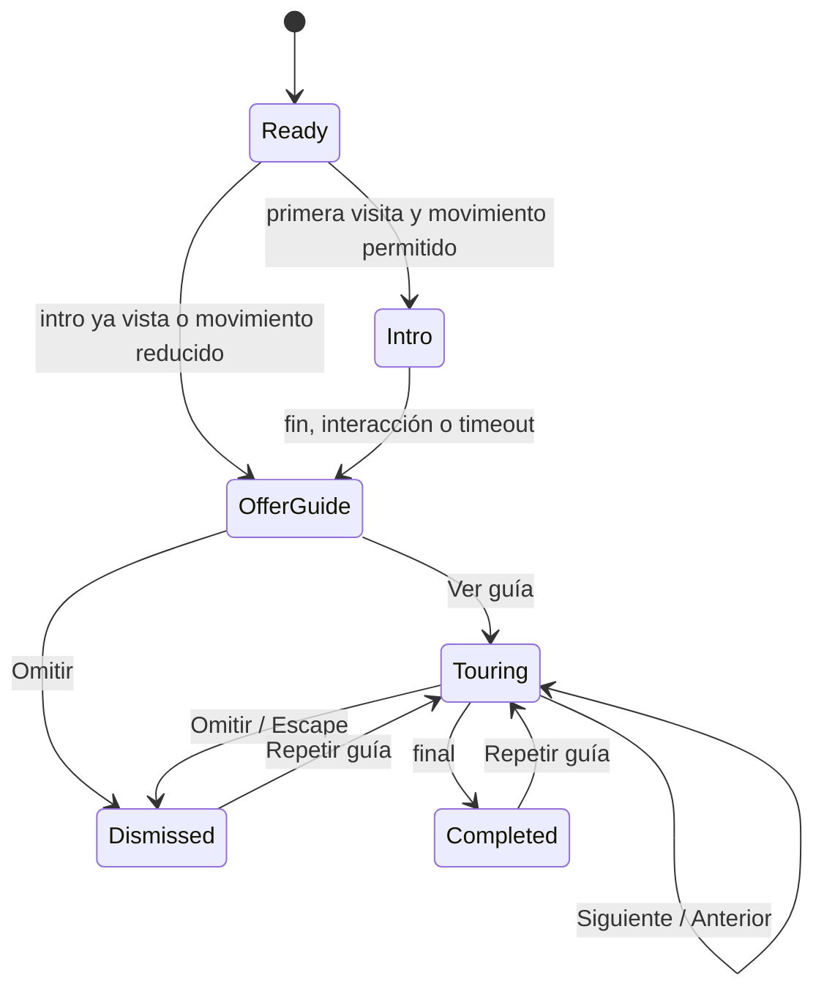

# Entrada de marca y onboarding contextual

Estado: storyboard y contrato de comportamiento; no animación implementada. Fecha: 2026-11-12. Relación: UX_UI_DESIGN_SYSTEM.md.

## Objetivo y límites

Dar identidad sin convertir una introducción en barrera. La interfaz y sus acciones se cargan inmediatamente. La animación es una capa decorativa no modal, `aria-hidden`, sin capturar puntero ni foco. Cualquier interacción del usuario la cancela antes de activar el control subyacente; no usar una máscara opaca que oculte acciones disponibles. Un foco que entra en la interfaz también cancela la capa. No esperar a descargar un modelo de IA ni a autenticar para mostrar Explorar.

Solo se reproduce automáticamente una vez por versión de introducción en ese navegador. El onboarding se ofrece tras la primera entrada y se inicia con «Ver guía»; se puede omitir en esa misma invitación. Así se conserva una entrada guiada sin un modal que asalte a cada visitante. La guía manual siempre está en Ayuda. No se infiere que todos los visitantes deseen animación.

## Storyboard de entrada (máximo propuesto 900 ms)

| Tiempo | Escena | Técnica conceptual / condición |
|---|---|---|
| 0–120 ms | Logotipo centrado sobre fondo neutro | Elemento decorativo; shell funcional presente debajo |
| 120–300 ms | Acento breve: apertura del umbral o escala 0.98→1 | Sin rebotes ni flashes; no rotación continua |
| 300–500 ms | Se revela fondo de identidad | Opacidad de capa cromática, sin barrido luminoso |
| 500–760 ms | Logo decorativo viaja a cabecera izquierda | Transformación al bounding box real del logo fijo |
| 650–900 ms | Entorno se revela progresivamente | Opacidad visual, contenido semántico no bloqueado |
| ≥900 ms | Capa se retira, guía disponible | No hay espera obligatoria ni pantalla splash bloqueante |

La cabecera real mantiene su caja desde el primer render; la copia animada no participa del layout. No mover físicamente el logo de navegación ni provocar layout shift. Si no puede calcularse destino estable, omitir desplazamiento y usar disolución. El logotipo final debe provenir de un activo autorizado: no se afirma haber rediseñado o copiado el original.

## Máquina de estados

Persistir `introVersionSeen`, `tourVersion`, `tourStatus` (never/dismissed/completed) y fecha solo localmente por defecto. Si almacenamiento no está disponible, funcionar sin error y no volver a abrir durante la sesión. Un cambio de versión no fuerza una guía completa: ofrecer nota opcional. En dispositivo compartido, no sincronizar preferencias de otra persona sin cuenta explícita.

## Guía de cuatro pasos sobre interfaz real

| Paso | Target semántico estable | Mensaje breve ES | Acción |
|---|---|---|---|
| 1/4 | Encabezado/filtro de objetivo de Explorar | «Elige qué oportunidad buscas. Puedes cambiarlo después.» | Siguiente / Omitir |
| 2/4 | Primera fila real o área de resultados | «Revisa la fuente, los requisitos y la fecha antes de decidir.» | Siguiente / Anterior / Omitir |
| 3/4 | Botón de explicación del detalle de ejemplo | «Aclara estos requisitos con ayuda de IA. Comprueba siempre la convocatoria.» | Siguiente / Anterior / Omitir |
| 4/4 | Destino Mi Ruta | «Guarda lo importante y elige tu próximo paso.» | Terminar / Anterior / Omitir |

Abrir un detalle durante la guía es navegación reversible, no guardado ni generación automática. Elegir una oportunidad real válida de datos actuales; si no existe, saltar paso 2/3 con contador actualizado, sin introducir contenido ficticio no rotulado. El paso 3 explica la función pero no transmite datos a IA. La ruta anterior y su scroll se restauran al finalizar cuando sea apropiado.

## Spotlight accesible

Resaltar mediante borde/halo y overlay decorativo. La explicación usa diálogo no modal asociado al target; no atrapará foco. Orden de tabulación: controles del paso y elementos reales, coherente con DOM. Mantener acceso a «Omitir» desde todos los pasos. `Escape` cierra y devuelve foco al disparador o al encabezado de la vista si aquel desapareció. `Enter` y `Space` activan botones nativos. Anunciar «Paso n de m» con cambios discretos; no leer la pantalla completa de nuevo.

No convertir un elemento inaccesible en «visible» solo recortando una máscara; el target debe estar realmente operable. Si se emplea un diálogo modal alternativo en móvil, aplicar foco confinado, `aria-modal` e inert al fondo coherentemente, pero no combinarlo con un target de fondo que se espera que el usuario active. Preferencia MVP: guía no modal, acciones de tarea no necesarias para avanzar.

## Responsive y situaciones difíciles

- 320/360/390: indicación como banda/bottom sheet de altura acotada, sin cubrir el target; hacer scroll al target antes de colocarla. Si no caben ambos, usar indicación inline y sin overlay.
- 768–1440: tooltip anclado con detección de colisiones, anchura máxima 320 px y margen mínimo 16 px al viewport.
- Horizontal de poca altura, teclado virtual abierto o zoom 200 %: usar bloque inline. Nunca fijar «Siguiente» fuera del área visible.
- Resize/orientación: recalcular anclaje sin reiniciar paso ni animar desplazamientos extensos.
- Target eliminado, catálogo vacío, deep link o error: posponer o saltar el paso con estado visible; nunca selector a un elemento inexistente.
- Entrada por URL de detalle: no redirigir a Explorar para mostrar la marca; ofrecer guía pertinente o acceso a repetirla.

## Movimiento reducido y rendimiento

Con `prefers-reduced-motion: reduce`, no escala ni viaje del logo ni revelados escalonados; mostrar cabecera y contenido directamente. Para cambios de preferencia durante ejecución, cancelar animación inmediatamente. No hacer del movimiento una fuente de significado exclusiva. La implementación preferirá transform/opacidad y recursos ya cargados; no video de introducción, librería pesada ni animación con temporizador bloqueante.

[MDN, prefers-reduced-motion](https://developer.mozilla.org/en-US/docs/Web/CSS/Reference/At-rules/@media/prefers-reduced-motion), consulta 2026-11-12, documenta la preferencia de movimiento. Las duraciones y la presentación son decisiones propuestas de UMBRAL, no recomendaciones universales del estándar.

## Criterios de aceptación y pruebas

1. Primer render permite explorar aunque la animación falle o JS de la guía se interrumpa.
2. Intro cumple la secuencia solicitada y dura ≤900 ms en condiciones de prueba, sin espera de red.
3. Cualquier entrada del usuario cancela la intro; no se pierde el primer clic.
4. Primera visita ofrece guía; siguiente visita no repite intro/guía; «Repetir» funciona.
5. Omitir/Escape funciona desde cada paso sin guardar datos de oportunidades.
6. Teclado y lector de pantalla acceden al texto, progreso y controles; foco retorna a un lugar lógico.
7. Todos los anchos pedidos, zoom y orientación mantienen target y controles visibles.
8. Movimiento reducido presenta interfaz estática, incluida preferencia cambiada en caliente.
9. No se generan solicitudes IA solo por ver la guía.
10. Pruebas automatizadas de estados y manuales con lector de pantalla se registrarán con navegador, versión, viewport y resultado. Estado actual: pendientes; no hay evidencia de ejecución.
