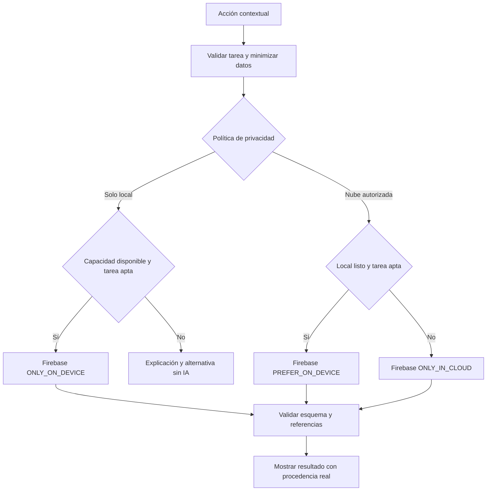

# Arquitectura de IA híbrida

Estado: diseño propuesto, no implementación ni prueba ejecutada. Consulta documental: **2026-11-12**. Todos los enlaces son oficiales. Los mínimos documentados no equivalen a versiones recomendadas para un nuevo proyecto; fijar versiones compatibles tras el spike inicial.

## 1. Decisión y límites

Todo acto de inferencia del producto concursante se realizará mediante **Firebase AI Logic**. No se usarán llamadas directas a Gemini, OpenRouter, ni `LanguageModel.prompt()` como ruta alternativa. La API del navegador puede consultarse para detectar disponibilidad; la generación sigue entrando por Firebase. El asistente contextual resuelve tareas delimitadas sobre una oportunidad seleccionada, no un chat general ni un agente de postulaciones.

Funciones propuestas: explicar requisitos en lenguaje sencillo; proponer una lista de preparación; sugerir próximos pasos. El catálogo y la elegibilidad explícita se calculan con datos y reglas, no con invención del modelo. Ninguna salida equivale a adjudicación de una beca, empleo o evaluación definitiva de elegibilidad.

## 2. Matriz real de compatibilidad

| Plataforma | Integración local documentada | Mínimo/documentación | Decisión MVP |
|---|---|---|---|
| Chrome escritorio | Gemini Nano mediante Chrome Prompt API | Firebase JS 12.5.0+, Chrome 139+; verificar flags/canal y hardware | Local condicionado; nube como alternativa autorizada |
| Chrome Android/iOS y otros navegadores móviles | No se documenta soporte local web equivalente | No extrapolar capacidades de apps nativas al navegador | Nube; lectura y Mi Ruta guardadas sin IA cuando no hay conexión |
| Otros navegadores escritorio | No garantía Firebase local | Feature detection, no detección por marca solamente | Nube o modo sin IA |
| Android nativo | ML Kit Prompt API, experimental/beta | Firebase AI Logic 17.10.0+, BoM 34.10.0+, dispositivos admitidos | Fase posterior |
| Apple nativo | Apple Foundation Models, integración experimental | Firebase AI Logic 12.13.0+, Apple Intelligence habilitado | Fase posterior |

Firebase Web admite generación de un turno, texto y ciertas imágenes; no ofrece equivalencia a chat local multitur­no. No ofrece herramientas/grounding, PDF/audio/video ni archivos por URL en local. Además, Live API y plantillas de prompts de servidor no están disponibles en el flujo híbrido, tampoco mediante fallback; no depender de Count Tokens para comparar ambas rutas. La observabilidad de Firebase para nube no acredita ejecución local. [Guía Web](https://firebase.google.com/docs/ai-logic/hybrid/web/get-started).

Android depende del dispositivo y modelo que enumera ML Kit; por ejemplo la familia Pixel 9 aparece en la tabla vigente. No se promete soporte universal. La guía permite texto, una imagen Bitmap y salida estructurada, pero no chat local multitur­no. Requiere `firebase-ai-ondevice` además de `firebase-ai`; el paquete on-device no está incluido en BoM y exige API 26. A diferencia de Web, no inicia automáticamente la descarga ante una solicitud sin modelo: hay que prepararla antes; las API de descarga/warm-up se documentan para Kotlin, no Java. [Guía Android](https://firebase.google.com/docs/ai-logic/hybrid/android/get-started), [dispositivos ML Kit](https://developers.google.com/ml-kit/genai).

Apple requiere habilitación por el propietario y descarga administrada por el sistema; la aplicación no puede activar Apple Intelligence ni forzar su descarga. La disponibilidad debe comprobarse antes de ofrecer ejecución local. Apple local admite entradas de texto, no las imágenes admitidas por las rutas Web/Android; la guía anuncia salida estructurada con documentación todavía pendiente. La integración requiere Swift Package Manager. La guía limita solicitudes locales a 4096 tokens y expresa prioridad/fallback mediante `HybridModel(primary:secondary:)`, no copiando los enums Web. Las capacidades propias deben validarse, no copiarse de Web. [Guía Apple](https://firebase.google.com/docs/ai-logic/hybrid/ios/get-started), [Apple Intelligence](https://support.apple.com/en-us/121115).

Las integraciones híbridas nativas Android y Apple son experimentales: las guías advierten que no están cubiertas por SLA ni política de deprecación y pueden cambiar de forma incompatible. Esto refuerza aplazar los clientes nativos hasta después del MVP Web.

### Divergencia documental que debe probarse

La guía Firebase conserva Chrome 139+ con configuración de flags, mientras la página Chrome consultada sitúa Prompt API Web estable en Chrome 148. No declarar que cualquier Chrome 139 funciona sin preparación. Usar Chrome estable actual y comprobar la combinación real SDK/API en el spike. Chrome indica Windows 10/11, macOS 13+, Linux o Chromebook Plus compatible; 22 GB libres para instalación, GPU con más de 4 GB VRAM o CPU con al menos 16 GB RAM y cuatro núcleos. El modelo puede eliminarse si el espacio baja de 10 GB. Descarga inicial requiere conexión adecuada; uso posterior local puede ser sin red. La disponibilidad también depende de idiomas/modalidades. [Chrome Prompt API](https://developer.chrome.com/docs/ai/prompt-api).

## 3. Orquestador propuesto



Secuencia contractual:
1. Validar `taskType`, idioma, longitud y oportunidad vigente. No entregar HTML crudo al modelo.
2. Comprobar existencia de API y `LanguageModel.availability()` con opciones coherentes con la tarea. Convertir el estado a `unavailable`, `downloadable`, `downloading`, `available` o `unknown`; nunca concluir disponibilidad solo por user agent.
3. Preparar el modelo con `model.initializeDeviceModel(callback)` después o durante una activación del usuario y antes de `generateContent`. El callback informa progreso; no bloquear navegación. La descarga puede tardar minutos. Con descarga pendiente, `ONLY_ON_DEVICE` espera; los modos preferidos pueden usar nube. Por ello el orquestador no debe llamar a generación antes de resolver política y estado visible. Esta secuencia está documentada, pero su funcionamiento en la combinación elegida sigue pendiente de prueba.
4. Matriz de capacidades propia por versión: idioma probado, tamaño de entrada, formato y tarea. Una petición incompatible va directamente a nube solo si está autorizada. La guía Web indica un máximo local de 9216 tokens; no tratarlo como presupuesto de palabras ni asumir un conteo portable entre modelos. El MVP usará entradas conservadoramente acotadas, con aviso y rechazo o nube autorizada ante exceso.
5. Aplicar tiempo máximo, cancelación y un único reintento controlado. No enviar automáticamente datos privados a nube por una excepción genérica.
6. Ejecutar mediante Firebase; validar JSON y campos, límites de longitud y referencias a fragmentos existentes. Si falla, mostrar el texto original y mensaje recuperable, no una respuesta fabricada.
7. Mostrar procedencia extraída del resultado del SDK. Si falta, indicar «procedencia no verificada», no inferirla del modo solicitado.

### Los cuatro modos

| Modo Firebase | Significado | Uso propuesto |
|---|---|---|
| `PREFER_ON_DEVICE` | Local disponible; alternativa nube | Tarea breve, consentimiento de nube vigente |
| `ONLY_ON_DEVICE` | Local o error | Privacidad estricta; nunca degradar a nube |
| `PREFER_IN_CLOUD` | Nube disponible; alternativa local | Solo tareas compatibles con ambas rutas |
| `ONLY_IN_CLOUD` | Nube o error | Capacidad no disponible localmente |

`result.response.inferenceSource` documenta `ON_DEVICE` o `IN_CLOUD` desde JS 12.5.0. El default documentado desde JS 13.0.0 es `gemini-3.5-flash-lite`; no depender implícitamente del default. Mantener modelo estable explícito y configuración versionada. [Configuración oficial](https://firebase.google.com/docs/ai-logic/hybrid/web/configuration-options).

## 4. Contratos y coherencia

Contrato conceptual, no API adicional del SDK:

```typescript
type InferenceTask = {
  requestId: string;
  kind: 'EXPLAIN_REQUIREMENTS' | 'PREPARE_NEXT_STEPS';
  opportunityId: string;
  sourceVersion: string;
  locale: 'es' | 'en';
  privacy: 'LOCAL_ONLY' | 'CLOUD_ALLOWED';
  sourceFragments: Array<{ id: string; text: string }>;
};
type Result = {
  requestId: string;
  schemaVersion: 1;
  summary: string;
  actions: Array<{ text: string; evidenceIds: string[] }>;
  unknowns: string[];
  source: 'ON_DEVICE' | 'IN_CLOUD' | 'UNVERIFIED';
  requestedMode: string;
  sourceVersion: string;
  latencyMs: number;
};
```

`requestId`, `source`, `latencyMs` y versión los asigna la aplicación, nunca el modelo. Cada petición recibe un identificador único; al cambiar de oportunidad, cancelar o emitir otra petición, invalidar el identificador anterior. Solo renderizar si el resultado coincide con `activeRequestId` y la versión/ficha activa. Si el SDK no cancela el trabajo, descartar su respuesta tardía sin fingir que se canceló el procesamiento. `evidenceIds` deben pertenecer a la entrada. Un resultado estructurado válido puede ser factual­mente incorrecto: evaluación semántica obligatoria. Firebase permite esquema local con `onDeviceParams.promptOptions.responseConstraint` y nube con `inCloudParams.generationConfig.responseMimeType`/`responseSchema`; configurar ambas rutas. [Salida estructurada](https://firebase.google.com/docs/ai-logic/hybrid/web/generate-structured-output).

## 5. Offline, rendimiento y evidencia de aceptación

Offline significa que la aplicación previamente cargada, datos cacheados y modelo ya disponible pueden atender las funciones admitidas. No significa descubrir vacantes nuevas, autenticar por primera vez, descargar modelo o confirmar vigencia sin internet. Etiquetar datos cacheados con fecha y exigir revisar fuente antes de postular.

Objetivos de ingeniería, no mediciones: shell utilizable sin esperar modelo; cancelación visible; concurrencia local máxima 1; entradas acotadas; registrar p50/p95 por hardware y fuente; medir tiempo a primer token, tiempo total, memoria observada y errores. No prometer menor latencia local ni ahorro energético sin ensayo comparativo. La descarga y ejecución consumen almacenamiento, memoria y batería aunque la inferencia local no tenga coste por token.

Pruebas pendientes: local disponible; modelo ausente; descarga cancelada; hardware incompatible; idioma no soportado; navegador móvil; offline tras precarga; nube sin autorización; App Check rechazado; cuota agotada; JSON inválido; contenido malicioso; cambio de modelo. Registrar SDK/browser/OS, tarea, `inferenceSource` real y traza sin contenido personal. Una captura del selector «local» no prueba ejecución. Demostración de cada ruta requiere respuesta real del SDK y evidencia complementaria de red; emuladores/mocks solo prueban control de flujo.

## 6. Decisiones abiertas

Probar compatibilidad de SDK actual con Chrome estable; validar calidad en español/inglés con corpus etiquetado; confirmar modelo estable, proveedor y coste; acordar presupuesto antes de habilitar facturación; comprobar si el jurado requiere preparación de Chrome. Ninguna prueba de dispositivo ni inferencia se ha ejecutado en esta fase.

## 7. Revalidación documental de cierre

Verificado de nuevo el **12-11-2026**: [entrada AI Logic](https://firebase.google.com/docs/ai-logic), [guía Web](https://firebase.google.com/docs/ai-logic/hybrid/web/get-started), [modos y procedencia](https://firebase.google.com/docs/ai-logic/hybrid/web/configuration-options), [Chrome](https://developer.chrome.com/docs/ai/prompt-api), [Android](https://firebase.google.com/docs/ai-logic/hybrid/android/get-started), [Apple](https://firebase.google.com/docs/ai-logic/hybrid/ios/get-started) y [salida estructurada](https://firebase.google.com/docs/ai-logic/hybrid/web/generate-structured-output). La revisión confirma disponibilidad documental, no compatibilidad ejecutada. La arquitectura incorpora una etapa de inicialización explícita y no confunde `availability()` con `inferenceSource`. Pruebas nuevas requeridas: generación durante descarga; cancelación y reintento sin envío inesperado; usuario sin permiso de nube; ausencia de soporte de plantillas en ruta híbrida.
