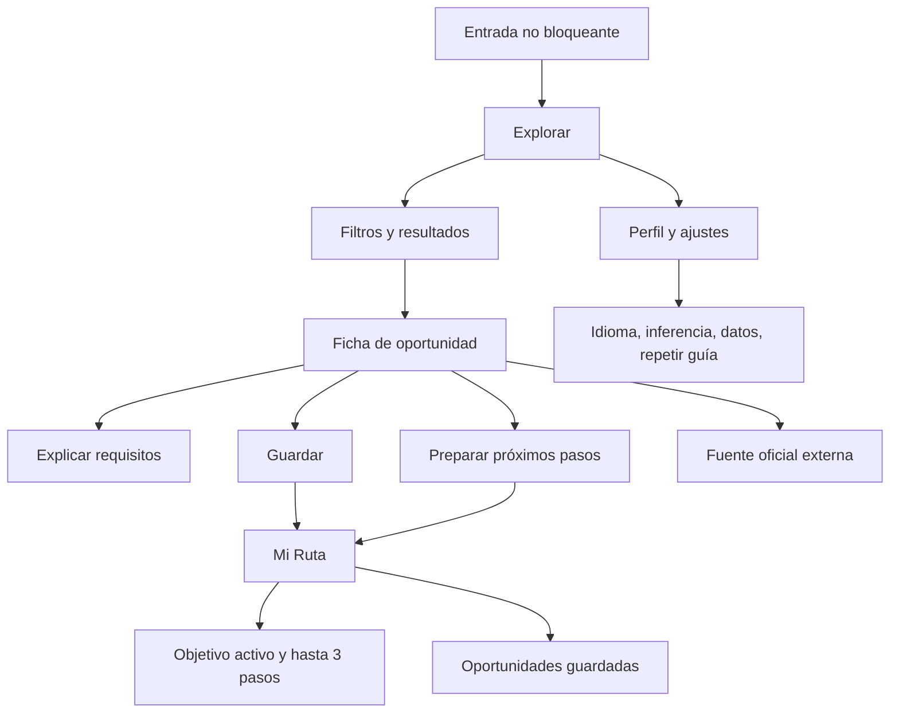
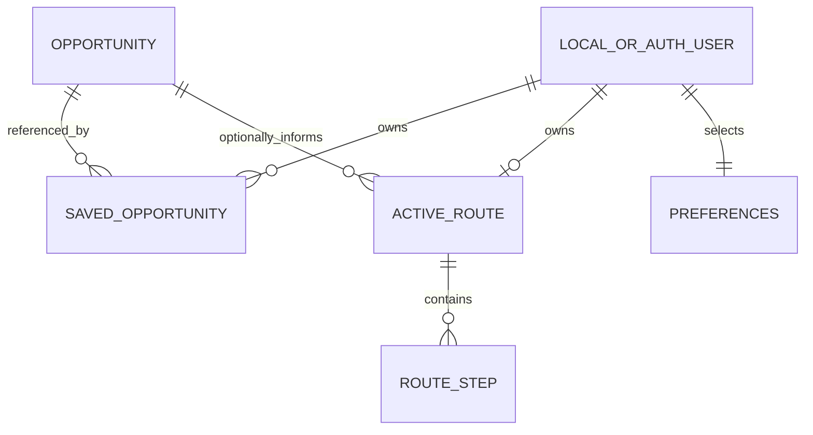

# Arquitectura de información

Discovery · 2026-11-12 · Diseño propuesto, no interfaz implementada.

## 1. Principio organizador

La oportunidad, no la conversación, es la unidad central. Navegación primaria del MVP: **Explorar** y **Mi Ruta**; **Perfil/Ajustes** es destino secundario accesible desde encabezado. En móvil la barra inferior contiene los dos destinos primarios, con texto e icono. Ayuda está dentro de Perfil/Ajustes; un tercer destino sólo se reconsidera tras evidencia de uso. No colocar un buscador global, un asistente flotante, un feed y un catálogo compitiendo por atención en la misma vista.

## 2. Rutas y jerarquía

| Ruta conceptual | Contenido esencial | Acción primaria | Secundarias |
|---|---|---|---|
| `/explore` | Propuesta de valor corta, búsqueda/filtros, lista | Abrir oportunidad | Ajustar filtros |
| `/opportunities/:id` | Título, entidad, estado, país/alcance, requisitos, coste, fecha, fuente | Ver próximos pasos o fuente según intención | Explicar, guardar |
| `/route` | Objetivo activo, siguiente paso, guardados | Continuar paso | Editar, cambiar estado |
| `/settings` | Idioma, preferencias de IA, almacenamiento, ayuda | Ajustar preferencia | Repetir guía, borrar datos |
| `/privacy` | Qué se almacena local/nube, propósito y controles | Volver | Contacto cuando esté definido |

Las rutas son contratos conceptuales; el framework podrá resolverlas sin alterar jerarquía. La ficha debe poder compartirse por URL pública sin incluir perfil, query de texto personal ni estado privado.

## 3. Estructura de la ficha

1. **Identidad:** categoría, título y entidad oferente.
2. **Decisión inmediata:** estado, alcance/elegibilidad, coste, modalidad y fecha límite. «No informado» ocupa el lugar del dato ausente.
3. **Acción:** fuente oficial y guardar; CTA IA contextual junto al bloque al que corresponde, no una caja de chat global.
4. **Requisitos:** lista fiel y fuente; explicación opcional adyacente o panel inferior.
5. **Próximo paso:** sugerencia editable, aceptada explícitamente antes de incorporarse a Mi Ruta.
6. **Confianza:** fecha de revisión, idioma fuente, límites de verificación y aviso de discrepancias.

En móvil el panel de explicación es una sección dentro del flujo o un sheet accesible que no tape controles. En escritorio puede ser panel lateral con orden de lectura coherente. No duplicar contenido para lectores de pantalla al cambiar layout.

## 4. Taxonomía y diccionario

| Campo | Tipo / valores | Regla semántica |
|---|---|---|
| `id` | Identificador estable | No depende del título traducido |
| `category` | employment, scholarship, course, entrepreneurship | Una primaria; no proliferar etiquetas |
| `title`, `summary` | Texto localizado o fuente | Traducción identificada |
| `providerName` | Texto | Entidad real, no UMBRAL por defecto |
| `sourceUrl` | URL | Fuente primaria, no enlace generado por IA |
| `sourceLanguage` | Etiqueta de idioma | Independiente de idioma UI |
| `eligibilityText` | Texto citado/resumido fiel | Condiciones oficiales visibles |
| `eligibleCountries` | Códigos de país + estado known/unknown | Lista vacía no implica mundial |
| `scope` | national/international/unknown | «Internacional» con evidencia |
| `modality` | online/in_person/hybrid/unknown | No deducir de categoría |
| `cost` | amount/currency + free/paid/unknown | Gratuito sólo si fuente lo afirma |
| `deadline` | fecha/instante + precisión y timezone opcional | Preservar precisión; no inventar hora |
| `requirements` | Lista de texto y referencia a fuente | Distinguir obligatorio/deseable sólo si consta |
| `status` | draft/open/review_required/closed/withdrawn | Publicación editorial separada de guardado |
| `verifiedAt`, `reviewBy`, `sourceVersion` | Fechas UTC y versión | Verificación realizada, próxima revisión y cambios de fuente; nombres canónicos |

Modelo de país no pretende resolver todas las reglas de nacionalidad/residencia; ambos conceptos se expresan en texto oficial cuando apliquen. Un filtro de país no equivale a validación legal de elegibilidad.

## 5. Información privada

Nombres conceptuales equivalentes: `SavedOpportunity` = `OpportunityTracking` y `RouteStep` = `Task`; la implementación elegirá los segundos como nombres canónicos de tipos. `SavedOpportunity` conserva opportunityId, estado declarado y timestamps. `ActiveRoute` contiene objetivo, referencia opcional y hasta tres `RouteStep` activos globales (pendiente o en curso; completada no consume cupo) con texto, estado de tarea (pendiente/en curso/completada), separado del seguimiento de la oportunidad, y fecha personal opcional. `Preferences` guarda locale, país de interés opcional y preferencia de inferencia. No almacenar respuesta completa de IA por defecto; guardar sólo los pasos que la persona confirme. Si se ofrece sincronización, separar datos privados por UID y resolver versiones; los guardados locales no se publican en el catálogo.

## 6. Búsqueda y orden

Para un catálogo de 12–20 fichas, búsqueda textual y filtros deterministas son suficientes. No introducir base vectorial, embeddings ni llamadas de IA por cada pulsación. Orden predeterminado: oportunidades abiertas y revisadas, con fecha conocida de próxima expiración; sin fecha se agrupan con etiqueta, no como urgencia fabricada. Debe poder explicarse el orden. Evitar cuenta atrás manipuladora y recomendaciones basadas en atributos sensibles.

## 7. Estados y lenguaje

| Componente | Estados obligatorios |
|---|---|
| Catálogo | carga, disponible, vacío por filtro, error, caché fechada |
| Ficha | abierta, cierre por confirmar, cerrada, retirada, no encontrada |
| Guardado | no guardado, guardando si aplica, guardado, error persistencia |
| Ruta | vacía con acción manual, activa, completada, conflicto si sync |
| IA | sin iniciar, comprobando, modelo descargable/preparando, ejecutando, cancelado, error, resultado validado |
| Backend | solicitado / detectado / ejecutado confirmado o desconocido |
| Guía | pendiente, activa, omitida, completada, repetida |

Mensajes orientados a recuperación: «No pudimos guardar en este dispositivo» + reintentar, en lugar de «Error 500». Mantener código técnico en diagnóstico no personal. Nunca mostrar «guardado» o «local» por anticipado.

## 8. Relación con requisitos y referencias

Explorar → RF-CAT-01, RF-SEARCH-01; ficha → RF-CAT-02, RF-AI-01/03; Mi Ruta → RF-SAVE-01, RF-ROUTE-01; ajustes → RF-PROFILE-01, RF-I18N-01, RF-ONB-01. Accesibilidad transversal → RNF-A11Y-01/02.

Referencias de base, elaboración 2026-11-12; verificación web en documentos especializados: [WAI: estructura de páginas](https://www.w3.org/WAI/tutorials/page-structure/), [WAI: formularios](https://www.w3.org/WAI/tutorials/forms/), [WCAG 2.2](https://www.w3.org/TR/WCAG22/). La taxonomía, rutas y esquema son decisiones propias para el MVP, no estándares impuestos por esas fuentes.

Límites de entrada del MVP: objetivo 1–120 caracteres, tarea 1–200, tras recortar espacios. El cuarto paso activo requiere completar o quitar otro; no se eliminan datos automáticamente. `verifiedAt` y `reviewBy` son fechas UTC y `sourceVersion` es una cadena de versión, no una fecha.
