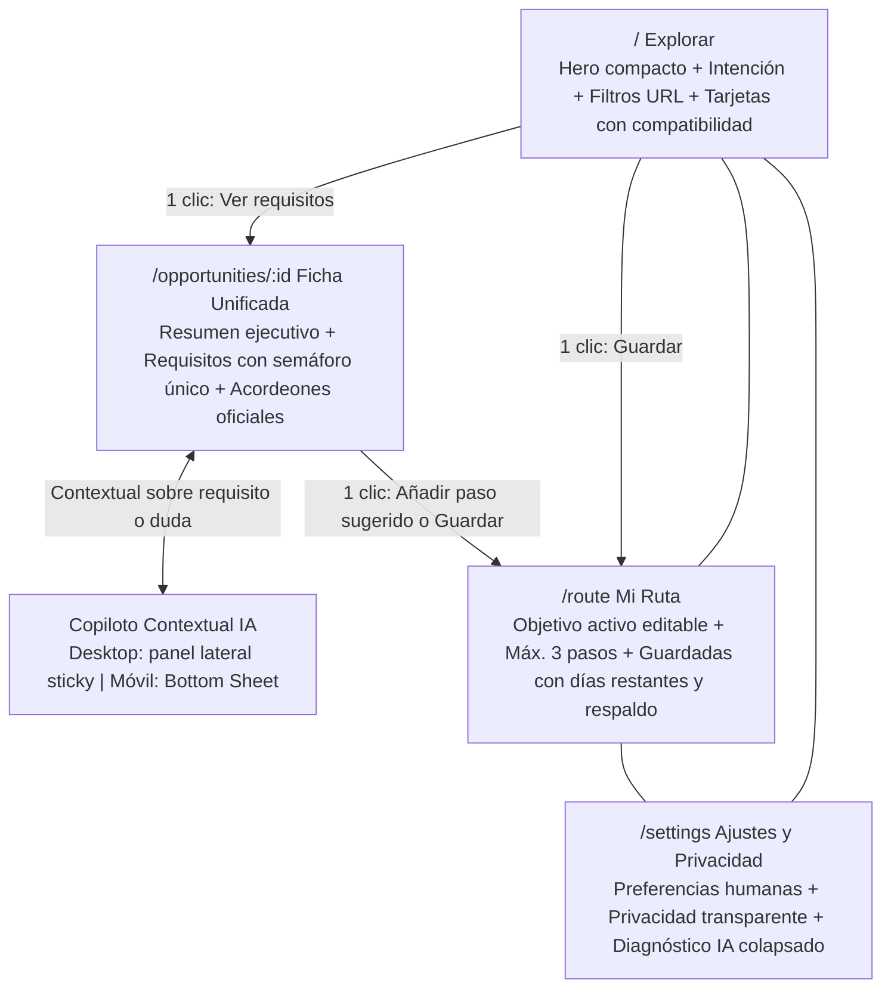

# Nueva Arquitectura de Información (IA) y Experiencia Rediseñada: UMBRAL

Este documento define la arquitectura estructural completa del nuevo **UMBRAL** tras redefinirlo como **Verificador de Elegibilidad y Copiloto de Preparación de Oportunidades Verificadas**. Cada vista, bloque y acción tiene una razón funcional explícita; todo lo que no responde a una pregunta real del usuario ha sido eliminado o movido a divulgación progresiva.

---

## 1. Principio rector: una pregunta principal por pantalla

| Vista / Módulo | Ruta | Pregunta humana que responde | Tiempo objetivo de comprensión |
| --- | --- | --- | --- |
| **Explorar** | `/` | *«¿Qué oportunidades verificadas existen para mi objetivo y cuáles encajan conmigo hoy?»* | `< 5 segundos` |
| **Ficha de Decisión** | `/opportunities/:id` | *«¿Califico realmente, qué requisitos me bloquean o faltan, y cuál es mi primer paso?»* | `< 15 segundos` |
| **Copiloto Contextual IA** *(junto a Ficha / Drawer móvil)* | Modal / Panel contextual dentro de `/opportunities/:id` | *«¿Qué significa esta cláusula oficial, qué documento preparo y qué hago primero?»* | Bajo demanda |
| **Mi Ruta** | `/route` | *«¿Qué decidí postular, cuántos días me quedan y qué 1 a 3 pasos ejecuto esta semana?»* | `< 5 segundos` |
| **Ajustes y Privacidad Unificados** | `/settings` (con ancla `#privacy` o pestaña) | *«¿Cómo protegen mis datos, en qué idioma quiero usar la app y quiero usar IA local o en la nube?»* | `< 10 segundos` |

---

## 2. Mapa de navegación simplificado

En lugar de exponer 4–5 rutas de primer nivel que mezclan tareas cotidianas con textos legales y diagnóstico técnico:



### Decisiones de navegación principal
- **Desktop (`>= 768px`):** Header limpio con 3 anclas directas de producto (**Explorar**, **Mi Ruta `[badge]`**, **Ajustes y Privacidad**) + conmutador deslizante **`ES | EN`** + píldora discreta **solo cuando requiere acción o muestra ejecución activa** (ej. *«IA lista»* o *«Solo local · offline»*), eliminando la cadena técnica *«Firebase configurado · Nube por probar»* que hoy ocupa espacio sin ayudar al usuario cotidiano.
- **Móvil (`< 768px`):** Barra inferior fija (`mobile-bottom-nav`) con 3 destinos claros de altura cómoda (`Explorar`, `Mi Ruta`, `Ajustes`). Se elimina `/privacy` como botón separado en footer/header y se integra dentro de `/settings` como primera tarjeta visual («Tu privacidad en Umbral») manteniendo `/privacy` solo como redirección o ruta compatible por URL directa para no romper enlaces existentes.

---

## 3. Arquitectura detallada vista por vista (con wireframes)

### 3.1. Inicio y Descubrimiento (`/`)
**Problema que resuelve:** En la versión actual no se ve ni una sola convocatoria en el primer pantallazo.  
**Solución estructural:** Hero de 1 idea + barra de filtros limpia que sincroniza query params (`/?q=...&cat=education&country=PE`) + chips visuales por categoría + tarjetas visibles sin scroll.

#### Wireframe Desktop (`1280x800`) — Todo el descubrimiento encima del pliegue
```text
+-----------------------------------------------------------------------------------+
| [UMBRAL]   Explorar   Mi Ruta (1)   Ajustes y Privacidad          [ES|EN] (i)     |
+-----------------------------------------------------------------------------------+
| Verifica si calificas antes de postular · 20 convocatorias de fuentes oficiales  |
| [ Buscar por beca, habilidad, empresa o ciudad…                       ] [Buscar]  |
| Categoría: (Todas) [Becas] [Empleo] [Cursos] [Emprendimiento]   País:[Todos v]    |
|                                                         [+ Más filtros (0)] [Limpiar]
+-----------------------------------------------------------------------------------+
| 14 oportunidades abiertas · Tu perfil (3/6 datos) activa compatibilidad [Editar]  |
|                                                                                   |
| +-------------------------------------------------------------------------------+ |
| | [BECA · Educación]  Abierta · Quedan 16 días        ETH Zürich · Zúrich (Pres.)| |
| | ETH Zürich ESOP · Beca de excelencia para máster 2027–28                      | |
| | Beneficio: Matrícula 100 % + CHF 13.500/semestre                              | |
| | Tu encaje: [● ● ○ ○] 1 por confirmar · Requisito clave: Grado + Top 10 %      | |
| | [ Comprobar requisitos y postular ]                  [ Guardar ]              | |
| +-------------------------------------------------------------------------------+ |
| +-------------------------------------------------------------------------------+ |
| | [EMPLEO / PRÁCTICA]  Abierta · Cierra 31 dic        AWS · Bogotá (Híbrido)    | |
| | Cloud Support Associate Intern · Práctica remunerada                          | |
| | ...                                                                           | |
+-----------------------------------------------------------------------------------+
```

#### Wireframe Móvil (`360px` / `390px`)
```text
+---------------------------------------+
| [UMBRAL]               [ES|EN]        |
+---------------------------------------+
| Verifica si calificas antes de        |
| postular                              |
| [ Buscar beca, empleo o ciudad…    ]  |
| (Todas) (Becas) (Empleo) (Cursos) ->  | <- scroll horizontal de chips táctiles
| [ País: Todos v ]  [ + Filtros (0) ]  |
+---------------------------------------+
| 14 abiertas · Compatibilidad activa   |
| +-----------------------------------+ |
| | [BECA]   Quedan 16 días           | |
| | ETH Zürich ESOP · Máster 2027–28  | |
| | Matrícula + CHF 13.500/sem        | |
| | Encaje: 2/4 · Falta tu título     | |
| | [ Revisar ficha ]   [ Guardar ]   | |
| +-----------------------------------+ |
+---------------------------------------+
| [Explorar]   [Mi Ruta (1)]  [Ajustes] |
+---------------------------------------+
```

**Reglas concretas en `/`:**
1. **Primera impresión instantánea:** Se elimina la caja gigante con 3 sub-tarjetas (`.steps-overview-grid`) y no se abre el tour flotante automáticamente al entrar. Si alguien quiere guía rápida, pulsa `? Cómo funciona` (abre un modal limpio de 3 pantallas o tour bajo demanda).
2. **Filtros por nivel (Ley de Hick):**
   - Nivel 1 siempre visible: Buscador + Chips con icono de Categoría (`Todas`, `Becas`, `Empleo`, `Cursos`, `Emprendimiento`, `Cívico`) + selector rápido de País (`PE`, `CO`, `MX`, `ES`, `US`, `INT`).
   - Nivel 2 dentro de popover **`+ Filtros`**: Modalidad (`Online`, `Presencial`, `Híbrido`), Idioma de convocatoria (`ES`/`EN`), Ventana de plazo (`Cierra pronto`, `Con fecha`, `Continua`), y Toggle `Incluir cerradas o por verificar (6)`.
3. **Diferenciación en tarjetas (`OpportunityRow`):**
   - Badge de color + icono de categoría (no píldora gris neutra).
   - **Cuenta regresiva legible en texto humano** cuando hay `deadlineAt` (*«Quedan 16 días · 30 nov 2026»*), badge neutro para continuas y badge ámbar claro para `review_required`.
   - **Línea destacada de beneficio concreto** (monto, beca, salario o certificación).
   - **Indicador pasivo de encaje (`Match Meter`)** calculado determinísticamente en cliente contra `profile` guardado (sin IA y sin latencia): muestra si hay algún `No coincide` de entrada o cuántos requisitos faltan confirmar.

---

### 3.2. Rediseño de la Ficha Principal (`/opportunities/:id`)
**Regla de prioridad en lectura (6 respuestas obligatorias de arriba hacia abajo):**
1. **Qué es y Quién convoca** (Categoría visual + Entidad verificada + Título balanceado).
2. **Para quién es** (Alcance geográfico/país + Modalidad + Condición excluyente clave en 1 línea).
3. **Si sigue disponible** (Semáforo de estado + Fecha límite exacta con zona horaria + Fecha de última verificación).
4. **Qué beneficios ofrece** (Bloque destacado de beneficio y costo conocido vs. «por confirmar»).
5. **Qué requisitos importantes tiene (FUSIÓN ÚNICA con Autocomprobación)** — **Adiós triple repetición**.
6. **Qué debería hacer el usuario** (Pasos oficiales para postular + botón Guardar + Abrir convocatoria oficial + botón contextual «Preguntar a la IA»).

#### Wireframe de Ficha Unificada (Desktop `>= 960px`: Lectura `1.35fr` + Copiloto sticky `0.95fr`)
```text
<- Volver a Explorar (conserva filtros)

+---------------------------------------------+ +---------------------------------+
| CABECERA DE DECISIÓN                        | | COPILOTO CONTEXTUAL DE IA       |
| [BECA] [Abierta · Quedan 16 d] [Verif.14/11]| | Modo: Privado en dispositivo    |
| ETH Zürich · Zúrich, Suiza (Presencial)     | |   (o Nube con tu permiso [v])   |
| ETH Zürich ESOP · Máster 2027–28            | |                                 |
|                                             | | Pregunta rápida sobre esta      |
| +-------------------+ +-------------------+ | | convocatoria:                   |
| | BENEFICIO         | | CIERRE            | | | [¿Qué significa un requisito?]  |
| | Matrícula 100% +  | | 30 nov 2026       | | | [¿Qué documentos necesito?]     |
| | CHF 13.500/sem    | | 11:59 CET (Zúrich)| | | [Proponer mis 3 primeros pasos] |
| +-------------------+ +-------------------+ | | [Comparar con otra guardada]    |
| [ Abrir sitio oficial ^ ] [ Guardar ]       | |                                 |
+---------------------------------------------+ | Tu duda específica:             |
                                                | [ Ej. ¿Sirve certificado B2?  ] |
+---------------------------------------------+ | [ Consultar ]                   |
| ¿CUMPLO LOS REQUISITOS? (Bloque único)      | |                                 |
| Tu perfil: Perú · Técnico · EN [Editar 4/6] | | --- Respuesta estructurada ---  |
| Semáforo: [0 Cumple] [1 Bloq] [2 Conf] [1 ?]| | Resumen claro + citas [1] [2]   |
|                                             | | [+ Añadir paso a Mi Ruta]       |
| [X] Grado universitario (Bachelor)          | +---------------------------------+
|     Obligatorio · Tu nivel actual: Técnico  |
|     [¿Qué alternativas tengo? -> IA]        |
|                                             |
| [!] Idioma (EN/DE) y prepropuesta de tesis  |
|     Obligatorio · Confirmar certificado     |
|     [¿Qué documento piden? -> IA]           |
|                                             |
| [?] Presencial tiempo completo en Zúrich    |
|     [Completar modalidad en mi perfil]      |
+---------------------------------------------+
| v Cómo postular paso a paso (Desplegable)   |
| > Condiciones adicionales y no informados   |
| > Fuentes oficiales y auditoría (2 enlaces) |
+---------------------------------------------+
```

**Por qué este diseño transforma la experiencia:**
- **Cero repetición:** Los requisitos aparecen en **un solo lugar**. Si el perfil está vacío (`0/6`), se ven limpios con su etiqueta «Obligatorio/Opcional» y el botón ligero `Completar mi perfil rápido (tarda 20 seg)` para activar los semáforos al instante.
- **Perfil colapsado en píldora interactiva:** Al pulsar `[Editar 4/6]`, se expande inline (o modal en móvil) el mini-formulario de 6 datos sin empujar todo el documento de manera permanente.
- **Divulgación progresiva real:**
  - Bloque 1 desplegable (abierto por defecto si va a postular o colapsable en 1 clic): **Cómo continuar en el portal oficial** (`officialInstructions`).
  - Bloque 2 acordeón cerrado por defecto: **Condiciones secundarias e información no publicada por la fuente** (`conditions` + `unknownFields`).
  - Bloque 3 acordeón cerrado por defecto: **Fuentes oficiales y fecha de próxima revisión** (`sources` + `reviewBy`).
- **Móvil (`< 960px`):** En lugar de enterrar la IA 2.500 px abajo, se coloca una **barra inferior pegajosa contextual** encima del bottom nav con `[ Abrir fuente oficial ]` + `[ Preguntar a IA ✨ ]` (que abre un **Bottom Sheet** limpio con altura controlada `max-height: 82dvh`).

---

### 3.3. Rediseño del Asistente Contextual de IA
**Regla de oro:** La IA explica, traduce a lenguaje cotidiano, compara y propone acciones; **nunca repite la ficha entera ni decide elegibilidad oficial**.

1. **Disparadores contextuales inline por requisito:** Cada requisito del bloque único tiene un micro-botón accesible *«Aclarar con IA»* que pre-rellena la pregunta exacta sobre esa cláusula en el Copiloto, evitando que el usuario tenga que redactar prompts desde cero.
2. **4 acciones de un toque en lugar de botones dispersos + chat técnico:**
   - **Explicar en palabras simples** (resume exclusiones críticas y requisitos difíciles sin repetir títulos).
   - **Lista de documentos y trámites previos** (detecta certificados, traducciones, constancias o trámites como CSE/CUL requeridos).
   - **Sugerir 3 pasos para Mi Ruta** (genera acciones concretas enviables con un clic al checklist).
   - **Comparar con otra convocatoria** (desplegable filtrado que prioriza convocatorias **guardadas o de la misma categoría**, avisando con honestidad cuando requiere conexión/consentimiento nube).
3. **Diferenciación cristalina Local vs. Nube (sin abrumar):**
   - Píldora única arriba del panel:
     - **En este dispositivo (Gemini Nano):** ícono `Cpu`, color verde salvia, texto *«Privado · Sin salir de tu navegador»*. Si está descargable, botón limpio *«Activar IA sin conexión»*. Si no es compatible en este equipo/GPU, texto breve honesto *«IA local no compatible en este equipo · Puedes usar Nube con permiso»* (sin errores en inglés).
     - **En la nube (Gemini Cloud · Firebase):** ícono `Cloud`, color índigo suave, texto *«Con internet y tu permiso»*. Si el usuario activa una acción en nube sin haber consentido antes, el banner de permiso aparece **justo en el momento de la acción**, en lenguaje claro y sin castigar el diseño previo.
   - El selector experto de 4 modos (`PREFER_ON_DEVICE`, `ONLY_ON_DEVICE`, `PREFER_IN_CLOUD`, `ONLY_IN_CLOUD`) desaparece de la superficie principal de la ficha (queda en Ajustes avanzados) y en el copiloto solo existe un selector humano de 2 o 3 opciones comprensibles: **Automático (privado local primero)** · **Solo sin conexión** · **Nube con mi permiso**.

---

### 3.4. Rediseño de Mi Ruta (`/route`) y Perfil Rápido
- **Objetivo único (`1/1`):** Si ya está definido, se muestra como tarjeta destacada con un botón `Cambiar objetivo`. Solo muestra el `<input>` cuando el usuario pulsa editar o aún no fijó meta.
- **Lista de hasta 3 pasos activos (`Máx. 3`):** Estilo checklist limpio (checkbox de completar, título del paso, enlace discreto si viene de una convocatoria, fecha límite voluntaria en formato legible y menú de acciones `Editar / Subir / Bajar / Quitar`).
- **Oportunidades guardadas enriquecidas:** Cada tarjeta guardada muestra **estado** (`Guardada` -> `Preparando` -> `Postulada` -> `Cerrada`), **días restantes al cierre**, **resumen automático de compatibilidad actual (`2/4 Cumples · 1 Bloq`)** y un acceso directo `+ Añadir paso desde esta ficha`.
- **Respaldo portátil (`.json` / `.md`):** Agrupado como barra secundaria discreta al pie de la página (para no robar jerarquía a los próximos pasos).

---

### 3.5. Rediseño de Ajustes y Privacidad (`/settings`)
Tres bloques limpios orientados a personas reales + 1 acordeón técnico para auditoría:
1. **Tu Privacidad en Umbral (siempre visible y simple):** 3 garantías cortas con iconos (*«Todo se guarda solo en tu navegador»*, *«No subimos documentos ni DNI»*, *«La IA en nube solo actúa si das clic en permitir»*).
2. **Preferencias:** Selector `ES | EN`, Preferencia de IA en palabras claras (con checkbox de permiso en la nube) y botón rojo de **Borrar mis datos locales** con confirmación.
3. **Acordeón colapsado por defecto: «Diagnóstico técnico para soporte / auditoría»** (revela navegador detectado, estado WebIDL de `window.LanguageModel`, estado `State A–D` de Firebase App Check, botón de descarga manual de Gemini Nano y log sin PII). Así se preserva la transparencia técnica exigida para el hackathon sin contaminar la experiencia cotidiana.

---

## 4. Verificación de la Regla de los Tres Clics

| Tarea crítica del usuario | Recorrido propuesto (activaciones de control) | Cumple `<= 3` clics |
| --- | --- | --- |
| **1. Encontrar una oportunidad pertinente** | Filtrar por chip de categoría (`1`) o país (`2`) en `/` -> resultados visibles al instante | **1–2 clics** |
| **2. Saber si califica y qué le falta** | Clic en tarjeta (`1`) -> ve semáforo unificado (si ya guardó perfil) o llena perfil rápido (`2`) -> resultado inmediato | **1–2 clics** |
| **3. Entender un requisito confuso con IA** | Clic en tarjeta (`1`) -> clic en *«Aclarar con IA»* en el requisito (`2`) *(+ aceptar permiso nube `3` si es primera vez)* | **2–3 clics** |
| **4. Guardar una oportunidad** | Clic directo en `Guardar` sobre la tarjeta en `/` (`1`) o en la cabecera de la ficha (`1`) | **1 clic** |
| **5. Convertir en próximo paso concreto** | Dentro de la ficha, tras pulsar *«Sugerir pasos»* (`1`), pulsar *«Añadir a Mi Ruta»* (`2`) | **2–3 clics** |
| **6. Consultar su plan y pasos sin conexión** | Abrir PWA -> clic en `Mi Ruta` (`1`) -> marcar paso completado (`2`) | **1–2 clics** |
