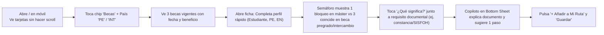

# Recorridos de Usuario, Auditoría de Funcionalidad y Valor Social: UMBRAL

Este documento responde a una exigencia crítica: **que UMBRAL no sea una vitrina de texto o tecnología, sino una herramienta que produzca un resultado real, medible y útil para una persona concreta**.

---

## 1. Cadena de Valor Social Tangible

Para cada usuario, UMBRAL debe cumplir siempre este ciclo completo en menos de 5 minutos:

| Etapa | Qué ocurre en la vida real del usuario | Cómo interviene el nuevo UMBRAL |
| --- | --- | --- |
| **1. Problema inicial** | Ve decenas de enlaces, PDFs de bases extensos, requisitos en otro idioma o miedo a no cumplir una condición oculta y perder semanas preparando papeles en vano. | Muestra oportunidades filtradas y verificadas con urgencia real visible desde el primer pantallazo en `/`. |
| **2. Acción que realiza** | En vez de leer 15 páginas de un reglamento, introduce 3 a 6 datos básicos sin cuenta ni DNI y revisa una ficha. | El motor determinista (`matcher.ts`) cruza al instante su perfil con las reglas publicadas sin enviar datos fuera. |
| **3. Ayuda que recibe** | Detecta rápidamente qué cumple, qué lo descalifica de raíz y qué cláusula ambigua necesita aclarar o preparar con tiempo. | Si tiene dudas en un punto específico, el Copiloto IA explica esa cláusula y sugiere hasta 3 acciones concretas basadas en las fuentes oficiales. |
| **4. Decisión informada que toma** | **O bien descarta en 2 minutos** una postulación inviable para concentrarse en una compatible, **o decide postular sabiendo exactamente qué requisito debe tramitar antes**. | Marca su decisión en *Mi Ruta* con un máximo realista de **1 objetivo y 3 próximos pasos** guardados en el dispositivo. |
| **5. Resultado tangible** | Llega al portal oficial (ETH, PRONABEC, AWS, etc.) con requisitos claros, documentación previa preparada y fecha límite bajo control, **aun estando sin conexión en el trayecto**. | Conserva acceso offline PWA a sus guardados, pasos y enlaces oficiales sin depender de cuentas ni nube. |

---

## 2. Recorridos de Usuario Detallados (4 Escenarios Reales)

### Escenario 1 · Lucía (21 años, estudiante universitaria en Chiclayo/Perú buscando beca 2027)
- **Contexto:** Usa su teléfono (`360x800`) con plan de datos prepago. Vio hablar de becas nacionales e internacionales, pero no entiende si necesita grado culminado, qué nivel de inglés aceptan o qué trámite previo exigiría una convocatoria focalizada en Perú.
- **Objetivo:** Encontrar 1 beca compatible con su perfil en Perú y anotar qué documento debe tramitar esta semana.

- **Resultado tangible:** En menos de 3 minutos descartó una beca que exigía licenciatura ya culminada (`MISMATCH`) y se quedó con una convocatoria viable y **1 paso concreto guardado** en su teléfono para reunir su constancia oficial esta semana.

---

### Escenario 2 · Mateo (24 años, egresado técnico de instituto en Colombia o Perú buscando práctica / primer empleo)
- **Contexto:** Navega desde laptop (`1280x800`), ya perdió tiempo enviando CV en portales masivos donde exigen permiso de residencia en EE. UU. o 3 años de experiencia ocultos al final del aviso.
- **Objetivo:** Comparar 2 convocatorias tecnológicas reales (`AWS Intern` vs otra opción híbrida) y decidir en cuál invertir su semana.

- **Paso a paso:**
  1. En `/`, selecciona chip `Empleo` + País `CO` (o `PE`) y busca `Cloud` o `Soporte`.
  2. La tarjeta muestra inmediatamente: categoría verde Esmeralda, *«Híbrido · Bogotá · En revisión verificada el 14 nov»* o fecha de cierre.
  3. Abre la primera ficha; su perfil (`CO`, `Técnico`, `Sin experiencia`, `Autorizado en CO`) sigue cargado de una visita anterior y el bloque único muestra `2 Coincide · 1 Por confirmar`.
  4. En el **Copiloto lateral sticky**, selecciona la segunda oportunidad en el comparador rápido y autoriza el uso de **Gemini Cloud (Firebase AI Logic)** al pulsar el botón explícito *«Permitir consulta en nube»*.
  5. Recibe una comparación concisa que contrasta requisitos de idioma, presencialidad y plazos sin inventar salarios no publicados.
- **Resultado tangible:** Selecciona la opción donde cumple todos los requisitos obligatorios, la marca como `Preparando` en *Mi Ruta* y agenda su primer paso (*«Actualizar certificado académico y confirmar cierre oficial»*).

---

### Escenario 3 · Valeria (19 años, usa PWA sin conexión en transporte público)
- **Contexto:** Guardó 2 oportunidades y 3 pasos en casa con Wi-Fi. En el bus camino a su facultad o municipalidad se queda sin cobertura móvil.
- **Objetivo:** Revisar qué documentos debía llevar y tachar su paso completado sin perder datos.

- **Paso a paso:**
  1. Abre el acceso directo de la PWA en su pantalla de inicio; el Service Worker sirve `/route`.
  2. Ve el banner discreto informativo *«Sin conexión · Mostrando tu ruta guardada en este dispositivo»*.
  3. Revisa la oportunidad guardada con sus **días restantes al cierre** y los **2 requisitos «Por confirmar»** resumidos sin necesidad de volver a descargar nada.
  4. Marca como completado el paso 1 (*«Confirmar DNI vigente y constancia de estudios»*). El contador sube a `1/3 completado` visualmente en la barra de progreso y la IA nube se muestra deshabilitada de forma transparente mientras no haya red (conservando local si tiene Gemini Nano).
- **Resultado tangible:** Continuidad real de preparación ante conectividad intermitente sin muros de carga ni errores en blanco.

---

### Escenario 4 · Andrés (30 años, profesional preocupado por privacidad usando Chrome Desktop con Gemini Nano)
- **Contexto:** No quiere crear cuenta ni enviar notas personales sobre su situación laboral o migratoria a servidores externos.
- **Objetivo:** Analizar requisitos en inglés complejo ejecutando todo al 100 % en su propia máquina.

- **Paso a paso:**
  1. Abre ficha de beca internacional y ve en el panel del Copiloto la píldora verde salvia: *«Privado en tu dispositivo (Gemini Nano)»* (o la activa desde Ajustes con descarga explícita).
  2. Elige modo **Solo en dispositivo (Cero nube)** (o mantiene automático sin dar permiso nube).
  3. Pulsa *«Explicar en palabras simples»* sobre un requisito en inglés; recibe la respuesta etiquetada con trazabilidad real **`Ejecutado en tu dispositivo (ON_DEVICE)`** y cero tráfico de red a Firebase.
- **Resultado tangible:** Confianza absoluta demostrada en red y UI: entendió bases en otro idioma sin exponer información personal fuera de su equipo.

---

## 3. Auditoría de Funcionalidad: Qué Conservar, Rediseñar, Simplificar o Eliminar

| Funcionalidad actual | Veredicto | Justificación centrada en valor real |
| --- | --- | --- |
| **Motor determinista 4 estados (`matcher.ts`)** | `CONSERVAR Y PROMOVER` | Es el mayor diferenciador honesto de Umbral frente a chatbots que alucinan elegibilidad. Debe estar en tarjeta (resumen) y en el bloque único de la ficha. |
| **Firebase AI Logic Híbrido + Consentimiento + Evidencia (`aiOrchestrator.ts`, `hybridAiAdapter.ts`)** | `CONSERVAR INTACTO EN BACKEND` | Arquitectura sólida y probada en producción. La mejora va en la capa de presentación e intención de preguntas, no en destruir el orquestador. |
| **Catálogo verificado con zona horaria y estado `review_required` (`opportunities.ts`)** | `CONSERVAR Y ENRIQUECER` | Añadir únicamente metadatos visuales (cuenta regresiva, monto/beneficio breve y micro-guía opcional para requisitos habilitantes como SISFOH/CUL). |
| **Lista plana duplicada «Requisitos publicados» + `SelfCheckPanel` separado** | `REDISEÑAR (FUSIONAR EN UNO)` | Eliminar la duplicación y colapsar los 6 campos del perfil en una píldora editable para que la compatibilidad sea instantánea. |
| **Bloque actual de `HybridAIPanel` (744 líneas visibles con selector técnico de 4 modos)** | `REDISEÑAR Y SIMPLIFICAR` | Reducir a Copiloto por 4 acciones claras + preguntas por requisito + píldora de privacidad humana; mover el selector de 4 modos técnicos a Ajustes avanzados. |
| **`OnboardingTour` automático en primera entrada + `.steps-overview-grid` en hero** | `ELIMINAR COMO DISPARO AUTOMÁTICO` | Si el inicio requiere un manual de 4 pasos flotando y 3 tarjetas explicativas para entenderse, falló la interfaz. Mantener `? Cómo funciona` opcional bajo clic en el header o héroe compacto. |
| **Página separada `/privacy` en la navegación principal** | `SIMPLIFICAR / FUSIONAR EN /settings` | Nadie navega a «Privacidad» como tarea frecuente; al fusionarla como bloque principal superior de `/settings` (manteniendo `/privacy` como ruta compatible/redirección), se limpia la navegación sin ocultar la transparencia. |
| **Banner duplicado del objetivo sobre su propio `<input>` en `MyRoutePage`** | `SIMPLIFICAR` | Mostrar modo lectura elegante con botón `Editar`; evitar repetir la misma frase dos veces seguidas. |
| **Diagnósticos técnicos visibles en abierto dentro de `/settings`** | `OCULTAR EN ACORDEÓN COLAPSADO` | Un usuario real no necesita ver `window.LanguageModel` ni `State C · App Check` a primera vista; un acordeón cerrado «Diagnóstico técnico» sirve igual a jueces y desarrolladores sin asustar al usuario. |
| **Creación de cuentas, CV upload, scraping masivo o módulo SISFOH completo** | `MANTENER FUERA DEL MVP` | Añaden fricción, riesgo legal de datos personales (PII) y complejidad sin resolver mejor el cuello de botella central. |

---

## 4. Métricas propuestas para medir impacto social y eficacia (Product KPIs)

UMBRAL **nunca debe medir éxito por «tiempo en pantalla» o número de clics en anuncios** (al contrario: pasar menos tiempo buscando y tomar una decisión correcta más rápido es éxito).

| Tipo | Métrica | Definición operativa | Objetivo de validación |
| --- | --- | --- | --- |
| **North Star Metric** | **Tasa de «Decisión Clara en Ruta»** | % de visitantes que abren una ficha, completan al menos 2 datos de su perfil (o revisan compatibilidad) y **guardan/añaden al menos 1 paso real** o **descartan explícitamente** tras ver un `MISMATCH`. | `>= 45 %` en pruebas moderadas |
| **Velocidad de descubrimiento** | **Tiempo hasta la primera ficha pertinente (`Time to First Match View`)** | Segundos desde que carga `/` hasta que la persona abre una convocatoria acorde a su país/categoría. | `< 20 segundos` |
| **Comprensión real** | **Precisión de distinción «Confirmado vs. Desconocido»** | En test con usuarios (5–10 participantes), % capaz de identificar correctamente 1 bloqueo y 1 requisito sin fuente oficial tras ver la ficha + IA. | `100 %` (cero confusión de elegibilidad garantizada) |
| **Eficacia de IA Híbrida** | **Utilidad percibida de respuesta IA (`Saved Step Rate from AI`)** | % de consultas al Copiloto donde el usuario pulsa `+ Añadir a Mi Ruta` o resuelve su duda sin abandonar la página confundido. | `>= 35 %` de sesiones con uso de IA |
| **Inclusión / Móvil** | **Tasa de finalización móvil (`360px`–`390px`)** | % de tareas completas (buscar -> evaluar -> guardar) completadas sin ayuda ni errores táctiles en smartphone. | `>= 85 %` |
| **Resiliencia Offline** | **Éxito de reapertura offline en `/route`** | % de cargas sin red en PWA instalada que muestran pasos, fechas y enlaces sin errores fatales. | `100 %` |
