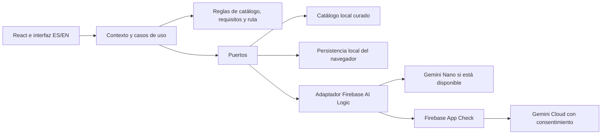

# Auditoría de integración e infraestructura — 14 de noviembre de 2026

## Alcance y conclusión

Revisión del árbol de trabajo local de `Alvaro-mendoza-12/umbral-hybrid-ai`, rama
`feat/hybrid-ai-web`, después de leer íntegramente `IDX_HANDOFF_GUIDE.md`.
El árbol ya contenía cambios de una sesión anterior; se conservaron.
No se modificó el repositorio anterior ni se realizaron commits, pushes o merges.
Después de la autorización explícita del propietario se realizó un único
despliegue, exclusivamente de Firebase Hosting en `umbral-21e8b`.

La aplicación compila y sus pruebas existentes pasan. La integración de Firebase
AI Logic funciona en desarrollo con una respuesta real de Gemini Cloud, App Check
debug registrado y diagnóstico `State D`. La aplicación también está publicada y
verificada en producción: reCAPTCHA Enterprise, respuesta real de Gemini Cloud y
`State D` desde `https://umbral-21e8b.web.app`, con las cabeceras de Hosting activas.

## Arquitectura observada



Se mantiene la separación entre dominio, puertos, adaptadores y presentación.
No hay un backend propio desplegable ni usos de Auth, Firestore o Storage en
`src`. Mi Ruta y el perfil se guardan localmente, sin sincronización entre equipos.
La presencia de dependencias de Firestore dentro del paquete Firebase no implica
que exista una base de datos configurada o utilizada por la aplicación.

El orquestador conserva los cuatro modos de inferencia, la puerta de
consentimiento, cancelación de solicitudes anteriores y tiempos máximos. El SDK
recibe `useLimitedUseAppCheckTokens: true` después de inicializar App Check.

## Cambios de esta sesión

- En `src/adapters/firebase/firebaseStatus.ts`, ambas lecturas de
  `VITE_APP_CHECK_DEBUG_TOKEN` devuelven una cadena vacía cuando `import.meta.env.PROD`
  es verdadero.
- Se añadieron tres regresiones de seguridad en `tests/unit/firebaseStatus.test.ts`:
  producción sin proveedor, producción con reCAPTCHA y debug en desarrollo.
  No se eliminó ninguno de los 42 tests previos ni de los 20 E2E.
- `.env.local` ya existía, estaba ignorado y apuntaba al proyecto y Web App
  indicados. No fue necesario recrearlo ni descargar de nuevo la configuración.
- Con autorización puntual se registró el token de este navegador de desarrollo
  y se habilitó reCAPTCHA Enterprise API, sin vincular facturación.
- Con autorización adicional se creó `UMBRAL Firebase Hosting`, una clave web por
  puntuación, sin desafíos ni modo de prueba, con validación de dominio activa.
  Se registró en App Check para la app Umbral, TTL de una hora y configuración de
  riesgo predeterminada. Console confirma `Registrada` / `Fraud Defense`.
- `.env.local` contiene la site key y el debug vacío. `.env.development.local`,
  también ignorado, contiene únicamente el ajuste debug `true` para desarrollo.
  Vite no carga ese archivo al compilar producción; no se guardó un UUID en él.
- Se aisló Playwright de las credenciales locales: el servidor E2E compila sin
  configuración Firebase en `dist-e2e.local`, sin sobrescribir `dist`. El test
  existente que decía probar ausencia de credenciales ahora comprueba realmente
  `State A`, en lugar de depender del proyecto personal y del antiguo `State B`.
  Conserva las verificaciones de consentimiento, privacidad, 404 y ausencia de
  errores. El conjunto sigue teniendo 20 E2E.

## Evidencia ejecutada

| Verificación | Resultado |
| --- | --- |
| `npm run typecheck` | Correcto |
| `npm run lint` | Correcto |
| `npm run test` | 45 tests en 10 archivos; incluye los 42 previos |
| `npm run build` | Correcto; SPA y service worker generados |
| `npx playwright test --reporter=list` | 20/20 correctos |
| `npx tsc --noEmit -p tsconfig.node.json` | Correcto; incluye configuración E2E |
| Paridad ES/EN | 325 claves por idioma, sin claves faltantes |
| Git y entorno | `.env.local` ignorado y no rastreado |
| Búsqueda de valores privados locales en archivos candidatos a Git | Sin coincidencias |

Un build adicional con un valor centinela de debug confirma que ese valor no
aparece en los chunks de producción, tampoco la lectura de la variable de entorno,
la asignación de debug de la aplicación ni el fallback de `CustomProvider`. El
SDK de Firebase conserva internamente el nombre de la variable global de debug:
su mera aparición como lector no demuestra que la aplicación active debug.

Playwright verifica flujos principales, accesibilidad Axe, ocho anchos de pantalla,
teclado, reflujo, persistencia, importación/exportación y recarga offline de `/route`.
Estos tests no sustituyen una prueba contra el proveedor de producción.
Tras registrar reCAPTCHA se repitieron typecheck, lint, los 45 tests, build y los
20 E2E. Se comprobó que el build real contiene la site key configurada sin la
asignación de debug, y que el build E2E no contiene las claves locales.

Prueba real de desarrollo:

- Navegador conectado a `http://127.0.0.1:5174` con consentimiento explícito.
- Explicación de requisitos de una oportunidad del catálogo público usando
  `ONLY_IN_CLOUD` y `gemini-3.5-flash-lite`.
- Respuesta renderizada y validada por la aplicación; `inferenceSource: IN_CLOUD`,
  latencia observada de 2822 ms.
- `/settings`: `State D` y `Firebase Cloud AI ready`.
- Después de separar la configuración de producción y desarrollo se repitió una
  solicitud real: `IN_CLOUD`, 2915 ms y de nuevo `State D`. Confirma que la laptop
  conserva su acceso de desarrollo con el token ya registrado; no es una prueba
  de reCAPTCHA desde un dominio autorizado de Hosting.
- Verificación adicional mediante la API REST oficial `:exchangeDebugToken`, con
  el mismo token de desarrollo registrado: HTTP 200, `limitedUse: true`, TTL 300 s.
  Esta verificación HTTP fue directa, no una captura de Network del navegador.
- El archivo temporal ignorado usado para esa verificación fue eliminado. No se
  documentan tokens, claves API ni respuestas de autenticación.

Las capturas y el resultado HTTP sin credenciales están en `artifacts.local/`,
ignorado por Git. No se incluyen secretos en este documento.

## Hallazgos y límites pendientes

1. **Producción validada funcionalmente en el dominio.** reCAPTCHA Enterprise
   tiene una clave web por puntuación registrada en App Check para
   `umbral-21e8b.web.app` y `umbral-21e8b.firebaseapp.com`. No se deben
   añadir dominios generales, desactivar la validación de dominio ni añadir
   localhost a la clave de producción. El propietario indicó que no tiene un
   dominio de preview; no se añadió Cloud Workstations ni ningún comodín.
   La solicitud real de producción confirmó `IN_CLOUD` y `State D`; los resultados
   del despliegue y el alcance de esta comprobación figuran más abajo.

2. **Dependencias: cuatro entradas altas de npm audit.** La cadena instalada es
   `firebase@13.3.0` → `@firebase/firestore@4.20.0` → `@grpc/grpc-js@1.9.16`, además
   del adaptador compat. Son entradas propagadas desde gRPC, no cuatro fallos
   independientes de la aplicación. El código de la SPA no importa Firestore ni
   gRPC; no se identificó una ruta de ejecución de servidor gRPC en esta revisión.
   Esto no elimina el hallazgo del árbol instalado. No se ejecutó
   `npm audit fix --force`: la propuesta automática degrada Firebase a 9.14.0 y
   compromete la integración actual de AI Logic. Requiere resolución específica
   y validación de compatibilidad, no una declaración de riesgo cero.
   La auditoría incluyendo herramientas de desarrollo devuelve 16 entradas:
   cuatro altas, diez moderadas y dos bajas; incluye cadenas de ESLint/TypeScript
   y Workbox/PWA. Esos resultados también necesitan mantenimiento antes de
   considerar saneada toda la cadena de suministro.

3. **Validación de evidencia de IA incompleta.** En
   `src/domain/aiContract.ts`, `normalizeItems` elimina identificadores inventados
   pero conserva el texto cuando no queda ningún `evidenceId` válido. La UI puede
   mostrar una acción sin fuente. Los tests actuales prueban esta tolerancia.
   Conviene decidir si se descartan esos elementos o se distinguen explícitamente
   como no respaldados. Tampoco una cita existente demuestra por sí sola que la
   afirmación esté sustentada semánticamente. No se cambió este contrato dentro
   del ajuste solicitado de configuración Firebase.

4. **Sin pipeline de CI versionado.** No existe `.github/workflows` en este árbol.
   Las pruebas de esta sesión son locales; no hay evidencia de una puerta
   automática de calidad en cada PR. No se creó un workflow que pueda desplegar.

5. **Autenticación de CLI resuelta con autorización.** `firebase-tools` 15.36.0
   inicialmente no tenía cuentas autorizadas. Se completó el flujo oficial de
   Google tras obtener confirmación puntual para los permisos OAuth de la CLI.
   La CLI confirmó el proyecto seleccionado `umbral-21e8b` y permitió el despliegue
   exclusivo de Hosting. Los códigos temporales no se guardaron en Git ni en este
   documento, y el archivo temporal ignorado se eliminó. Node 26 provoca una advertencia
   de compatibilidad de `superstatic`; la herramienta declara Node 20/22/24.

6. **Gemini Nano no disponible en este contexto.** El navegador expone
   `LanguageModel`, pero el sondeo devuelve `unavailable`. No se descargaron
   modelos ni cambiaron flags del navegador. Una respuesta Cloud no verifica la
   inferencia local; ese recorrido necesita un entorno compatible.

7. **Documentación con estados históricos.** Algunos documentos de discovery
   aún dicen que no existe implementación y una checklist anterior cuenta 41
   tests. Este informe describe las verificaciones actuales sin sobrescribir
   indiscriminadamente el historial. No se revalidaron en Internet las fuentes
   editoriales de las 20 oportunidades durante esta revisión de infraestructura.

## Preparación final y límites de publicación

Firebase Hosting sirve `dist`, conserva el rewrite SPA y aplica CSP y las cabeceras
de seguridad verificadas mediante HTTP en ambos dominios públicos. La prueba de
reCAPTCHA se hizo sobre la versión publicada, no mediante `vite preview`.
No se utilizó el despliegue previo en Vercel ni se cambió App Check o la facturación
durante este despliegue. Cualquier publicación posterior requiere nueva autorización.

### Revisión previa al despliegue autorizado

El propietario autorizó exclusivamente Hosting en `umbral-21e8b`, sin commits,
pushes, merges ni modificaciones de App Check o facturación. Se verificó de nuevo:

- Directorio `D:\umbral-hybrid-ai`, rama `feat/hybrid-ai-web` y remoto correcto.
- `firebase.json` contiene únicamente `hosting`, publica `dist` y no define otro
  sitio, target ni hooks de despliegue.
- Nuevo `npm run build` correcto; 19 archivos en el artefacto final.
- Site key reCAPTCHA configurada presente en el bundle. Configuración debug vacía,
  sin asignación que active debug, sin fallback de CustomProvider y sin UUIDs
  incrustados. El nombre global que el SDK puede leer no constituye un token.
- Ningún archivo `.env`, archivo de claves privadas ni patrón de cuenta de
  servicio, clave privada o refresh token detectado en `dist`.
- La configuración pública Web de Firebase forma parte del bundle, como requiere
  el SDK; no se confunde con una clave privada de servicio.
- Manifiesto SHA-256 del artefacto guardado únicamente en el directorio ignorado
  `artifacts.local`, para comprobar que se publica lo revisado.

La CLI no tenía una cuenta autenticada. Se inició el flujo oficial de login y se
obtuvo autorización puntual antes de conceder los permisos OAuth amplios que
solicita Google. El inicio de sesión terminó correctamente. `firebase use` confirmó
`umbral-21e8b`; la consulta de sitios confirmó su sitio de Hosting y URL pública.
Los hashes del artefacto continuaban intactos justo antes de publicar.

### Despliegue y comprobaciones reales de producción

Se ejecutó una sola operación de despliegue, usando la CLI oficial mediante npx:

```sh
npx --yes firebase-tools deploy --only hosting --project umbral-21e8b
```

La salida confirmó `deploying hosting`, 19 archivos, carga completada, versión
finalizada, publicación completada y `Deploy complete!`. No se ejecutó ningún
despliegue adicional ni se cambiaron servicios, App Check o facturación.

| Comprobación posterior | Resultado real |
| --- | --- |
| `https://umbral-21e8b.web.app` | HTTP 200 y título correcto de UMBRAL |
| `https://umbral-21e8b.firebaseapp.com` | HTTP 200 y título correcto de UMBRAL |
| `/settings` en ambos dominios | HTTP 200; rewrite SPA operativo |
| Integridad del artefacto servido | 19/19 archivos con HTTP 200 y SHA-256 idéntico al build revisado |
| Cabeceras en ambos dominios | CSP, nosniff, DENY, Referrer-Policy y Permissions-Policy presentes |
| App Check en la app publicada | `reCAPTCHA Enterprise (tokens limitados de IA)` |
| Firebase Console, AI Logic | Protección básica aplicada; métricas agregadas 100 % verificadas y 0 % no verificadas |
| Solicitud real desde `web.app` | `EXPLAIN_REQUIREMENTS`, `ONLY_IN_CLOUD`, `gemini-3.5-flash-lite` |
| Respuesta de Gemini renderizada | `inferenceSource: IN_CLOUD`, 4171 ms |
| Diagnóstico en `/settings` | `State D` / `Firebase Cloud AI listo` |
| Consola del navegador observada | 0 errores y 0 advertencias durante la comprobación |
| Plan de facturación observado | Spark, sin cambios |

Se usó una oportunidad del catálogo público con consentimiento explícito en la
interfaz. No se enviaron documentos ni datos personales de autocomprobación.
La respuesta estructurada se validó y se renderizó con sus identificadores de
evidencia. En el navegador de producción no se activó debug ni se usó el token
local: el bundle revisado contiene la configuración debug vacía y la interfaz
identifica el proveedor Enterprise.

La validación de reCAPTCHA/App Check es funcional de extremo a extremo: una
respuesta real fue aceptada por AI Logic mientras su protección básica estaba
aplicada y el cliente utilizaba Enterprise. Los porcentajes de Console son
agregados, no una traza individual de esta solicitud. No se capturaron ni
almacenaron tokens de producción. La protección contra repetición aparece
desactivada en Console; se mantuvo así, tal como se solicitó, aunque el SDK pide
tokens de uso limitado.

La prueba real de inferencia se hizo en `web.app`. En `firebaseapp.com` se verificó
la entrega HTTP, rutas y cabeceras; no se duplicó la solicitud de Gemini.
`State D` describe el éxito confirmado en esa sesión, no una promesa de que se
conserve después de recargar o ante fallos futuros de red/cuota.

Evidencia local ignorada por Git: `hosting-deploy-preflight.json`,
`hosting-preflight-manifest.json`, `hosting-production-http.json`,
`production-browser-result.json`, `production-state-d.png` y
`production-appcheck-metrics.png`, dentro de `artifacts.local/`.

## Referencias oficiales consultadas

- [Modelos compatibles con Firebase AI Logic](https://firebase.google.com/docs/ai-logic/models)
- [App Check y protección contra reutilización](https://firebase.google.com/docs/ai-logic/app-check)
- [Proveedor debug web](https://firebase.google.com/docs/app-check/web/debug-provider)
- [Proveedor reCAPTCHA Enterprise web](https://firebase.google.com/docs/app-check/web/recaptcha-enterprise-provider)
- [API exchangeDebugToken](https://firebase.google.com/docs/reference/appcheck/rest/v1/projects.apps/exchangeDebugToken)
- [Aviso gRPC sobre certificados](https://github.com/grpc/grpc-node/security/advisories/GHSA-m9gg-hp2v-232j)
- [Aviso gRPC sobre mensajes de error](https://github.com/grpc/grpc-node/security/advisories/GHSA-f596-whhp-79r4)

---

## Adenda final Release Candidate — 14 de noviembre de 2026 (22:00 PET)

Tras el despliegue previo verificado arriba (`https://umbral-21e8b.web.app` con la compilación anterior), se realizó la intervención final de producto UX/UI y verificación integral en el árbol local (`D:\umbral-hybrid-ai`, rama `feat/hybrid-ai-web`) **sin modificar la aplicación publicada ni ejecutar nuevos despliegues, commits o pushes**:

- **Arranque y navegación (`Run` / `/`):** se incorporó `"start": "vite"` en `package.json`, `server: { host: true, port: 5173 }` en `vite.config.ts`, anclaje superior limpio desde el logotipo/Explorar (`Shell.tsx`) y ajuste no invasivo del popover de `OnboardingTour.tsx` para evitar cubrir los botones CTA principales del hero.
- **UX/UI y selector `ES / EN`:** hero de propósito en `/`, resumen visual de 3 pasos, conmutador segmentado deslizante `LanguageSwitch.tsx` con alineación estable en móvil (`360px`), marcador visual de 4 estados en `SelfCheckPanel.tsx`, eliminación de sufijos internos `(req-*)` / `(cond-*)` en la ficha de detalle y tira comparativa de estado real Nano vs Cloud en `HybridAIPanel.tsx`.
- **Verificación HTTP en vivo de las 4 entradas `review_required` (14-11-2026):** las cuatro URLs oficiales respondieron `HTTP 200` (`pe-promigas-billing`, `pe-xylem-electromechanical`, `co-aws-intern` y `es-cybersecurity-94`); se actualizó `verifiedAt`/`sourceVersion` y `unknownFields` manteniendo `editorialStatus: 'review_required'` de forma conservadora porque ninguna confirma en vivo por API cuotas finales o plazas asignadas en tiempo real sin contacto directo.
- **Sonda real de Chrome 157 Gemini Nano en este equipo:** en contexto seguro local (`http://127.0.0.1`), `typeof window.LanguageModel === 'function'`, pero tanto en modo `headless: true` como `headless: false` la llamada `window.LanguageModel.availability()` devolvió `"unavailable"` y `window.LanguageModel.create()` lanzó `NotSupportedError: Unable to create a text session because the service is not running.` Queda documentado como bloqueo de hardware/entorno para `ON_DEVICE` real; ver [GEMINI_NANO_SETUP.md](GEMINI_NANO_SETUP.md).
- **Auditoría `npm audit --omit=dev` y registros upstream (14-11-2026):** `npm view` confirmó `firebase@13.3.0`, `@firebase/firestore@4.20.0` (fijando `@grpc/grpc-js: ~1.9.0`, instalado `1.9.16`) y `@grpc/grpc-js@1.14.7` en npm. Sin actualización compatible por semver dentro de `firebase@13.3.0`; el paquete `@grpc/grpc-js` sigue ausente del bundle de producción en `dist/assets/*.js`.
- **Comprobación visual local de `dist/` (`vite preview` en `127.0.0.1:4174`):** 0 errores de consola y 0 excepciones JS, mostrando en `/settings` `Configurado (umbral-21e8b)`, `reCAPTCHA Enterprise (tokens limitados de IA)`, `gemini-3.5-flash-lite` y `Estado C` (sin gastar cuota adicional de Gemini Cloud en local, preservando el `State D` ya comprobado previamente en producción).
- **Suite automatizada final tras la última edición:** `tsc --noEmit`, `eslint .`, `vitest run` (**10 archivos / 46 pruebas**) y `npx playwright test --reporter=list` (**21 pruebas E2E/Axe WCAG 2.2 AA**), detalladas en [TESTING_EVIDENCE.md](TESTING_EVIDENCE.md) y [FINAL_RELEASE_REPORT.md](FINAL_RELEASE_REPORT.md).

---

## Adenda de hardening final de Firebase App Check y validación de producción — 15 de noviembre de 2026 (00:35 PET)

Revisión final de seguridad ejecutada sin commits, pushes, merges ni nuevos despliegues, y sin modificar el enforcement en Firebase Console ni la facturación (`Spark`).

### 1. Dominios autorizados finales de reCAPTCHA Enterprise

Se actualizó y verificó mediante la API oficial `recaptchaenterprise.googleapis.com` (`PATCH` HTTP 200 y `GET` HTTP 200) la clave `projects/2458204140/keys/6Ldd0CAuAAAAAMVvBxE_k5sGIh6AXyS7icvQA5xy` (`UMBRAL Firebase Hosting`):

- `webSettings.allowAllDomains`: `false`
- `webSettings.integrationType`: `"SCORE"`
- `webSettings.allowedDomains` finales (exclusivos):
  - `umbral-21e8b.web.app`
  - `umbral-21e8b.firebaseapp.com`
  - `umbral-hybrid-ai.vercel.app`
- **Eliminados:** `vercel.app`, `localhost`, `127.0.0.1` (no se usan comodines ni se desactiva la verificación de dominio). El desarrollo local utiliza el proveedor debug (`VITE_APP_CHECK_DEBUG_TOKEN=true` en `.env.development.local`), deshabilitado explícitamente cuando `import.meta.env.PROD` es verdadero en [firebaseStatus.ts](../src/adapters/firebase/firebaseStatus.ts).

### 2. Estado de App Check, Replay Protection y tipo de token

Consultado directamente mediante la API oficial de Firebase App Check (`GET https://firebaseappcheck.googleapis.com/v1beta/projects/umbral-21e8b/services/firebaseml.googleapis.com` y `.../recaptchaEnterpriseConfig`, HTTP 200):

- **Protección estándar (Baseline protection) en `firebaseml.googleapis.com` (Firebase AI Logic):** **`ENFORCED`** (`updateTime: 2026-11-15T00:23:26.129823Z`).
- **Configuración reCAPTCHA Enterprise vinculada a la Web App (`1:2458204140:web:3ee64e487472f3c97b32c9`):** `tokenTtl: "3600s"`, `riskAnalysis.minValidScore: 0.5`.
- **Estado de Replay Protection:** **`Unenforced` / `Disabled`** en Firebase Console (conservado sin cambios por restricción del propietario).
- **Implicaciones de seguridad según documentación oficial (`https://firebase.google.com/docs/ai-logic/app-check`):**
  - Los **tokens de sesión** (`appCheck.getToken()`, TTL configurado `3600s` = 1 hora) proveen **Baseline protection** y son cacheados y reutilizados hasta expirar. Mientras Replay Protection permanezca `Unenforced`, un atacante que intercepte un token válido desde un cliente comprometido podría reutilizarlo contra el endpoint dentro de esa ventana de 1 hora (aunque solicitudes sin token válido o desde dominios no autorizados siguen bloqueadas por `Baseline protection: ENFORCED`).
  - Los **tokens de uso limitado** (`useLimitedUseAppCheckTokens: true` -> `appCheck.getLimitedUseToken()`, TTL `300s`) emiten una atestación nueva por cada petición para ser consumidos una sola vez cuando Replay Protection pasa a `Enforced`, añadiendo una ligera latencia por llamada.
- **Estado actual despliegue vivo vs árbol local:**
  - Los despliegues actualmente publicados en Vercel y Firebase Hosting (previos a esta auditoría final, intactos por la prohibición de redesplegar) operan con **tokens de sesión** (`3600s`).
  - El árbol de código local ([firebaseApp.ts](../src/adapters/firebase/firebaseApp.ts)) restaura **`useLimitedUseAppCheckTokens: true`** sincronizado con `appCheckReady`, listo para publicarse cuando el propietario autorice un despliegue.

### 3. Solución de la condición de carrera y auditoría de `withAppCheckRetry()`

- **Causa raíz de la carrera en frío:** en `@firebase/app-check`, `initializeAppCheck(..., { isTokenAutoRefreshEnabled: true })` dispara inmediatamente `state.exchangeTokenPromise` ejecutando el widget invisible reCAPTCHA Enterprise, mientras que `getLimitedUseToken()` (`useLimitedUseAppCheckTokens: true`) omite `state.exchangeTokenPromise` y llama directamente a `provider.getToken(true)` sobre el mismo `widgetId`. Una llamada inmediata a Gemini Cloud tras cargar la página colisionaba con esa ejecución inicial.
- **Solución sincronizada sin debilitar protección:**
  - [firebaseApp.ts](../src/adapters/firebase/firebaseApp.ts) exporta `appCheckReady: Promise<void>` en `InitializedFirebaseServices`, inicializado como `getToken(cachedAppCheck, false).then(() => undefined).catch(() => undefined)` al registrar App Check.
  - [hybridAiAdapter.ts](../src/adapters/firebase/hybridAiAdapter.ts) espera `await awaitWithAbort(services.appCheckReady, input.signal)` en `runStructuredTask` (cuando `preference !== 'ONLY_ON_DEVICE'`) y en `runCloudFollowUp`, garantizando que el widget e intercambio inicial hayan concluido antes de solicitar tokens de uso limitado, respetando `AbortSignal`.
- **Hardening de `withAppCheckRetry()` y `chat.sendMessage`:**
  - `isTransientAppCheckError()` limita el reintento únicamente a fallos transitorios pre-flight de adquisición de token App Check / reCAPTCHA en cliente (`appCheck/recaptcha-error`, `appCheck/network-error`, `appCheck/fetch-status-error`, `AppCheck: ReCAPTCHA error`), y rechaza reintentar `AbortError`, `TimeoutError`, `429`/`RESOURCE_EXHAUSTED`, `INVALID_AI_OUTPUT`, bloqueos de seguridad/cuota o respuestas `PERMISSION_DENIED`/`UNAUTHENTICATED`.
  - Mantiene límite estricto de **1 reintento** (máximo 2 intentos totales) con backoff de `900 ms` cancelable inmediatamente vía `AbortSignal`.
  - En `runCloudFollowUp`, `model.startChat({ history: sdkHistory.map(...) })` se crea **dentro** del callback de `withAppCheckRetry` con copia del historial, garantizando una instancia nueva de `ChatSession` por intento para evitar duplicar turnos conversacionales en `@firebase/ai`.

### 4. Validación de producción actual (sin modificar el despliegue)

Ejecutada tras restringir `allowedDomains` exclusivamente a los 3 dominios de producción:

| Superficie / Acción probada | Resultado observado |
| --- | --- |
| `https://umbral-hybrid-ai.vercel.app/` | `HTTP 200` + `CSP`, `X-Frame-Options: DENY`, `X-Content-Type-Options: nosniff`, `Referrer-Policy: strict-origin-when-cross-origin`, `Permissions-Policy` |
| `https://umbral-21e8b.web.app/` | `HTTP 200` + las 5 cabeceras de seguridad activas |
| `https://umbral-21e8b.firebaseapp.com/` | `HTTP 200` + las 5 cabeceras de seguridad activas + `exchangeRecaptchaEnterpriseToken` `HTTP 200` |
| Vercel — **App Check + Sugerir 3 pasos** | `exchangeRecaptchaEnterpriseToken` `HTTP 200`, `gemini-3.5-flash-lite:generateContent` `HTTP 200` (`IN_CLOUD`), 0 errores |
| Vercel — **Documentos necesarios** | `gemini-3.5-flash-lite:generateContent` `HTTP 200` (`IN_CLOUD`), 0 alertas |
| Vercel — **Consultar en nube** | `gemini-3.5-flash-lite:generateContent` `HTTP 200` (`IN_CLOUD`, respuesta con cita `[meta-cost-deadline]`) |
| Vercel — **Guardar en Mi Ruta** | Acción añadida y persistida en `/route` (`1` tarea activa) |
| Firebase Hosting (`web.app`) — **Sugerir 3 pasos** | `exchangeRecaptchaEnterpriseToken` `HTTP 200`, `gemini-3.5-flash-lite:generateContent` `HTTP 200` (`IN_CLOUD`), 0 errores de página |

### 5. Revisión de secretos, variables y artefacto `dist/`

- `git check-ignore -v .env.local .env.development.local`: ambos ignorados por `.gitignore`; `git ls-files .env*` devuelve únicamente `.env.example`.
- Variables en Vercel (`alvaro-s-projects1/umbral-hybrid-ai`): únicamente las 8 variables públicas `VITE_*` (`VITE_FIREBASE_API_KEY`, `VITE_FIREBASE_AUTH_DOMAIN`, `VITE_FIREBASE_PROJECT_ID`, `VITE_FIREBASE_STORAGE_BUCKET`, `VITE_FIREBASE_MESSAGING_SENDER_ID`, `VITE_FIREBASE_APP_ID`, `VITE_RECAPTCHA_ENTERPRISE_SITE_KEY`, `VITE_FIREBASE_AI_CLOUD_MODEL`) en `Production`, `Preview`, `Development`; `VITE_APP_CHECK_DEBUG_TOKEN` ausente.
- Análisis de los 15 chunks JS de `dist/assets/`: `hasDebugTokenAssign: false`, fuga de valor de debug token `false`, `hasPrivateKey: false` (sin credenciales de servicio), `hasSiteKey: true`, `hasLimitedUseFlag: true`.

### 6. Pruebas ejecutadas en el árbol local tras el hardening final

| Comprobación | Resultado |
| --- | --- |
| `npm run typecheck` (`tsc --noEmit`) | Aprobado (`exit 0`) |
| `npx tsc --noEmit -p tsconfig.node.json` | Aprobado (`exit 0`) |
| `npm run lint` (`eslint .`) | Aprobado (`0` errores, `0` advertencias) |
| `npm run test` (Vitest) | **10/10** archivos, **51/51** pruebas aprobadas (incluye `withAppCheckRetry`, exclusión de no-AppCheck/`AbortSignal` y `runCloudFollowUp` sin duplicación de turnos) |
| `npm run build` | Aprobado (`0.408 s`, 22 entradas PWA precacheadas) |
| `npx playwright test --workers=3 --reporter=list` | **21/21** pruebas E2E y Axe WCAG 2.2 AA aprobadas (`29.3 s`) |

### 7. Riesgos restantes y acciones humanas pendientes

- **Riesgos restantes:**
  1. El despliegue vivo actual (sin redesplegar por restricción) sigue emitiendo tokens de sesión (`3600s`) hasta que el propietario autorice publicar el árbol local ya endurecido (`useLimitedUseAppCheckTokens: true` + `appCheckReady`).
  2. `Replay Protection` sigue desactivado en Firebase Console; mientras no se active en Console tras desplegar tokens de uso limitado, un token de sesión interceptado sería reutilizable dentro de su TTL de 1 hora.
  3. Deuda transitiva conocida de dependencias sin ruta de ejecución en el navegador (`@grpc/grpc-js@1.9.16` bajo `firebase@13.3.0`) y ausencia de Gemini Nano activo en el hardware Windows de prueba (`unavailable`).
- **Acciones humanas pendientes:**
  1. Autorizar y ejecutar el próximo despliegue del árbol local a Vercel y Firebase Hosting para activar en producción `useLimitedUseAppCheckTokens: true` sincronizado con `appCheckReady`.
  2. Una vez desplegado y validado en métricas de Firebase Console > App Check > APIs > Firebase AI Logic que no haya tráfico con `Unverified: Reused token`, activar **Replay Protection = Enforced** en Firebase Console.
  3. Realizar `commit` / `push` en Git cuando el propietario lo autorice.

