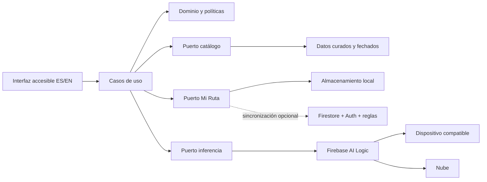

# Arquitectura de software

Estado: propuesta de discovery, 12-11-2026. Ningún componente ha sido implementado ni probado en este repositorio.

## Decisión y alternativas

Se propone un **monolito modular web**, con límites de dominio y puertos/adaptadores pragmáticos, no una implementación ceremonial de Clean Architecture. Una sola aplicación desplegable y servicios gestionados reducen operaciones para una hackathon. Hexagonal describe dependencias, no obliga a desplegar servicios separados. Clean Architecture aporta independencia de reglas y pruebas; se adopta selectivamente. Microservicios añaden despliegues, observabilidad y coordinación injustificados para este alcance. Eventos sirven más adelante para actualización de catálogo y métricas, pero no son necesarios para completar un flujo; ningún bus de eventos en el MVP. Riesgo: un único despliegue y límites de módulos que pueden erosionarse; mitigar con interfaces y pruebas.

## Capas y módulos

- Presentación: rutas, componentes accesibles, traducciones y estados de carga/error.
- Aplicación: casos de uso buscar, consultar, guardar, actualizar ruta y explicar. Orquesta sin lógica de presentación.
- Dominio: oportunidad, fuente, requisito, usuario/ruta; valida reglas independientemente de Firebase.
- Adaptadores: repositorio de catálogo curado, almacenamiento local, Firestore y AI Logic. Las interfaces pertenecen a aplicación/dominio. Ninguna clave privada en cliente.
- Infraestructura Firebase solo donde aporte: Authentication para sincronización opcional; Firestore con reglas para datos propios; App Check y AI Logic según configuración verificada; Remote Config opcional, no requisito para demo.

## Modelo y contratos

`Opportunity`: id estable, categoría, título, organización, país/región, modalidad, idioma, URL oficial, fecha límite y zona horaria cuando existan, `verifiedAt`, `reviewBy`, `sourceVersion`, estado de vigencia y fuentes específicas para cada requisito. No asumir que faltar una fecha implica convocatoria abierta. `Requirement`: texto, fuente y última revisión. `OpportunityTracking`: opportunityId y estado (guardada/preparando/enviada/cerrada). `Task`: texto, estado (pendiente/en curso/completada), fecha opcional y vínculo opcional a una oportunidad. Un único objetivo activo y hasta tres tareas activas globales; oportunidades guardadas no tienen límite propuesto. Perfil mínimo y voluntario: país, idioma y objetivos; evitar datos sensibles.

El catálogo debe distinguir `verifiedAt` (se comprobó fuente) de `reviewBy` (revisión pendiente); el enlace oficial es la autoridad y la verificación no garantiza validez futura. Versionar esquema y validar datos al importar. Los datos de prueba deben rotularse como tales, sin oportunidades inventadas en demo presentada como real.

Contrato conceptual `explain(context, preference) -> {status, text, sourceRefs, requestedMode, executionEvidence?}`. El estado distingue éxito, no disponible, sin red, cancelado, error o formato inválido. El SDK web documenta `response.inferenceSource` como fuente local/nube; comprobarlo con la versión real en integración. Si falta o no se puede validar, informar `unknown`, nunca inferirlo de la preferencia solicitada. Validar salida y mostrar enlaces; ningún resultado de modelo determina elegibilidad.

## Flujos

1. Carga de catálogo validado → filtros deterministas → ficha con fuente y vigencia.
2. Guardar → estado local → confirmación; sincronizar únicamente tras elección de usuario, autenticación y reglas verificadas. Conflictos deben resolverse por política explícita y sin pérdida silenciosa; no prometer sincronización hasta probarla.
3. Explicar requisito → mostrar contexto enviado y opción de procesamiento → orquestador AI Logic → validar respuesta → ficha con advertencia y fuentes. Sin red y sin modelo local disponible, conservar navegación y explicar que IA no está disponible.

## Seguridad y evolución

Principio de mínimo privilegio, validación por límites, reglas Firestore que restringen escritura a su propietario, App Check como defensa complementaria y no autorización, salida de IA como no confiable, y revisión de enlaces y datos no verificables. No pegar datos de salud, identificación o financieros en prompts. Separar proyectos y entornos solo cuando estén autorizados. Registrar fallos sin prompts ni identificadores personales; establecer cuotas y umbrales antes de exposición pública. En crecimiento, externalizar ingestión editorial como trabajo aislado y usar eventos con idempotencia y colas solo si hay necesidad demostrada. Pruebas y diagramas describen el diseño, no pruebas ejecutadas.
